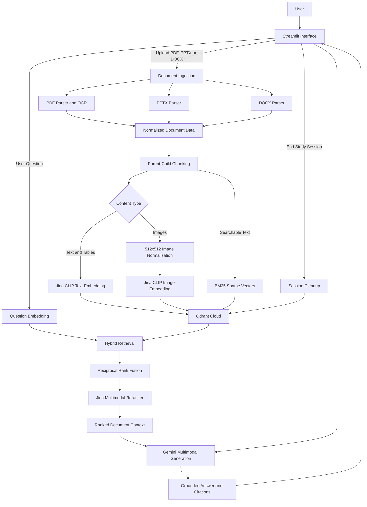

# Multimodel RAG

### A multimodal document intelligence and study assistant powered by hybrid retrieval and grounded generation.

Multimodel RAG is a multimodal Retrieval-Augmented Generation (RAG) application designed to make complex documents searchable, understandable, and interactive.

Instead of relying on text extraction alone, the application processes the different forms of information contained in PDF documents, PowerPoint presentations, and Word files, including text, tables, diagrams, and images.

Users can upload their own learning materials and interact with them through a conversational interface. Questions are answered using retrieved document content, with source citations that allow users to trace answers back to the original material.

The system combines semantic retrieval, BM25 keyword search, multimodal embeddings, and neural reranking to improve the relevance of retrieved information before passing it to a language model for answer generation.

**The objective:** turn static documents into an interactive knowledge base without losing the context and references that make the original material useful.

---

## Core capabilities

| Feature | Description |
| --- | --- |
| Multiformat ingestion | Processes PDF, PPTX, and DOCX documents. |
| Multimodal extraction | Extracts text, tables, and images from supported documents. |
| Semantic retrieval | Finds conceptually relevant content, even when search terms differ. |
| BM25 keyword search | Retrieves exact terminology, names, and technical expressions. |
| Hybrid search | Combines dense and sparse retrieval using Reciprocal Rank Fusion (RRF). |
| Neural reranking | Re-evaluates retrieved candidates to improve relevance. |
| Grounded generation | Generates answers using retrieved document context. |
| Source citations | Connects generated answers to identifiable document locations. |
| Session isolation | Separates indexed document content using unique session identifiers. |
| Embedding cache | Reuses previously generated embeddings to reduce redundant API requests. |
| Session cleanup | Deletes session-associated Qdrant records and extracted image files. |

## Why hybrid multimodal retrieval?

Traditional keyword search is limited when a user's question expresses an idea differently from the original document. Pure semantic search, on the other hand, can overlook exact technical terms or named entities.

Multimodel RAG combines complementary retrieval techniques to address these limitations.

**Semantic retrieval**

Uses dense embeddings to identify passages with similar meaning rather than relying exclusively on exact word matches.

**BM25 sparse retrieval**

Captures exact terminology, technical phrases, identifiers, and other keyword-dependent matches.

**Reciprocal Rank Fusion (RRF)**

Combines dense and sparse retrieval rankings into a unified candidate list.

**Multimodal embeddings**

Allows the retrieval pipeline to represent both textual and visual content rather than treating documents as plain text files.

**Neural reranking**

Uses a second-stage ranking model to evaluate the retrieved candidates more carefully before generation.

**Grounded answer generation**

Provides the language model with selected document context and generates answers with references to their supporting sources.

This architecture is particularly useful for academic material, technical documentation, lecture presentations, research papers, and documents where important information is distributed between text and visual content.

---

## System architecture

The application follows a document-ingestion and retrieval pipeline, separating file processing, embedding generation, indexing, retrieval, reranking, and answer generation into dedicated components.



### 1. Document ingestion and indexing

When a document is uploaded, the ingestion manager identifies its format and delegates processing to the corresponding parser.

- **PDF:** PyMuPDF handles document extraction, with Tesseract OCR used for scanned content.
- **PPTX:** python-pptx processes PowerPoint presentations.
- **DOCX:** python-docx processes Word documents.

Extracted information is converted into a normalized document representation.

The chunking component then organizes the content using a parent-child strategy. This separates searchable child chunks from their broader parent context.

Text and tables are processed through the text embedding pipeline, while extracted images are normalized and processed through the image embedding pipeline.

The resulting embeddings are indexed in Qdrant Cloud. Searchable text is also represented using BM25 sparse vectors.

Each indexed chunk carries a session identifier to support retrieval isolation.

### 2. Hybrid retrieval and reranking

When a user submits a question, the application performs the following operations:

1. Generates a dense embedding for the question.
2. Performs dense vector retrieval through Qdrant.
3. Performs sparse BM25 retrieval against indexed text.
4. Combines the ranked results using Reciprocal Rank Fusion (RRF).
5. Passes retrieved candidates through the Jina multimodal reranker.
6. Selects the most relevant textual and visual context for generation.

The two-stage retrieval approach allows the system to consider both conceptual similarity and exact keyword matches before generating a response.

### 3. Grounded answer generation

The selected retrieval results are passed to Google Gemini through the `google-genai` SDK.

The model uses the supplied context to produce an answer supported by the retrieved document material.

Answers can include references such as:

- `lecture-notes.pdf - Page 4`
- `lecture-slides.pptx - Slide 7`
- `reading.docx - Paragraph 12`

Each `[Source N]` citation corresponds to a readable source entry maintained by the application. Internal identifiers remain available for application-level tracing without exposing raw JSON identifiers to the user.

---

## Technology stack

| Component | Technology |
| --- | --- |
| Application interface | Streamlit |
| Programming language | Python 3.10+ |
| Text and image embeddings | Jina `jina-clip-v2` |
| Multimodal reranking | Jina `jina-reranker-m0` |
| Language model | Google Gemini |
| AI integration | `google-genai` |
| Vector database | Qdrant Cloud |
| Sparse retrieval | Qdrant BM25 sparse vectors |
| PDF processing | PyMuPDF |
| OCR | Tesseract |
| PowerPoint processing | `python-pptx` |
| Word processing | `python-docx` |
| Image processing | Pillow |
| Local embedding cache | SQLite |

---

## Getting started

### Prerequisites

Before running the application, ensure you have:

- Python 3.10 or newer.
- Git.
- A Qdrant Cloud account and API credentials.
- A Google Gemini API key.
- A Jina API key.
- Tesseract OCR installed locally.

### 1. Clone the repository

```powershell
git clone https://github.com/Hiteshpydev/UNILM-.git
cd UNILM-
```

### 2. Create a virtual environment

```powershell
python -m venv venv
```

Activate it using Windows PowerShell:

```powershell
.\venv\Scripts\Activate.ps1
```

### 3. Install dependencies

```powershell
python -m pip install --upgrade pip
pip install -r requirements.txt
```

### 4. Configure Tesseract OCR

Install Tesseract OCR separately.

The current PDF OCR integration expects the Windows executable at:

```text
C:\Program Files\Tesseract-OCR\tesseract.exe
```

Make sure the executable is installed at this location.

### 5. Configure environment variables

Copy `.env.example` to `.env` and populate the required credentials:

```dotenv
GEMINI_API_KEY=your_gemini_api_key

QDRANT_URL=https://your-qdrant-cluster-url
QDRANT_API_KEY=your_qdrant_api_key

JINA_API_KEY=your_jina_api_key
```

**Security:** Never commit `.env` or expose API credentials in source code, screenshots, or public repositories.

### 6. Launch the application

```powershell
streamlit run app/app.py
```

Streamlit will provide a local application URL.

Open it in your browser, upload your learning material, and start asking questions.

---

## Embedding efficiency and caching

Repeated embedding requests can introduce unnecessary latency and API consumption.

To reduce redundant operations, the application maintains a local SQLite embedding cache at:

```text
data/embedding_cache.sqlite3
```

The cache uses the following information to identify reusable embeddings:

- Embedding model.
- Input type.
- Embedding dimensions.
- Content hash.

When identical content is processed again under the same configuration, the existing embedding can be reused rather than generating another Jina embedding request.

### Image normalization

Before embedding and reranking, images are normalized to:

```text
512 x 512 pixels
RGB colour space
```

This provides a consistent input format and avoids unnecessarily sending large original image files through the visual processing pipeline.

---

## Session isolation and lifecycle management

The application uses session-scoped indexing to prevent content from different study sessions from appearing in one another's retrieval results.

Each session receives a unique UUID, which is attached to its Qdrant points and applied as a retrieval filter.

When a user selects **End Study Session**, the application performs the following cleanup sequence:

1. Deletes the session's Qdrant points using a session-specific payload filter.
2. Waits for the Qdrant deletion operation to complete.
3. Verifies that no matching points remain.
4. Removes session-extracted image files.
5. Clears the relevant Streamlit session state.

The application reports successful cleanup only after the deletion and verification process has completed.

**Important:** Closing or refreshing a browser tab does not automatically execute the server-side cleanup routine. Users should explicitly select End Study Session and wait for the confirmation message.

---

## Project structure

```text
UNILM-/
├── app/
│   ├── app.py                       # Streamlit application
│   │
│   ├── chunking/
│   │   └── chunker.py               # Parent-child chunking
│   │
│   ├── embeddings/
│   │   └── embedder.py              # Jina embeddings and SQLite cache
│   │
│   ├── generation/
│   │   └── generator.py             # Gemini answer generation
│   │
│   ├── ingestion/
│   │   ├── ingestion_manager.py     # File-format routing
│   │   ├── pdf_parser.py            # PDF extraction, OCR and images
│   │   ├── pptx_parser.py           # PowerPoint processing
│   │   └── docx_parser.py           # Word document processing
│   │
│   └── retrieval/
│       ├── indexer.py               # Embedding and vector indexing
│       ├── retriever.py             # Hybrid retrieval and RRF
│       ├── reranker.py              # Multimodal reranking
│       └── vector_store.py          # Qdrant operations and cleanup
│
├── data/                            # Local embedding cache
├── extracted_images/                # Runtime image extraction
├── tests/                            # Regression and component tests
├── .env.example                      # Environment configuration
├── requirements.txt                  # Python dependencies
└── README.md
```

---

## Testing

Run the focused regression tests from the repository root:

```powershell
python -m unittest tests.test_embedder tests.test_reranker tests.test_vector_store_cleanup -v
```

The current regression tests cover:

- Image resizing and normalization.
- Embedding-cache reuse.
- Reranker image normalization.
- Session-specific Qdrant cleanup.

These tests help verify important components of the retrieval and session-management pipeline.

---

## Troubleshooting

### The application does not generate an answer

- Verify that all required API keys are configured correctly.
- Check your internet connection and access to the external services.
- Confirm that the uploaded document contains extractable content.
- Inspect the Streamlit terminal for the underlying error.

### Images are not being extracted

- Confirm that the document contains embedded images supported by the parser.
- Verify that the extraction directory is writable.
- Check the PDF parser and OCR output.

### Tesseract OCR cannot be found

- Confirm that Tesseract is installed.
- Verify that the executable exists at the configured Windows path.
- Restart the application after installation or path changes.

### Qdrant records remain after ending a session

- Use End Study Session and wait for the success confirmation.
- Verify the configured Qdrant URL and API key.
- Inspect the returned cleanup error to identify the failed operation.

---

## Privacy and security considerations

Multimodel RAG uses external services for embedding, reranking, vector storage, and answer generation.

Important considerations:

- Store API credentials in environment variables rather than source code.
- Keep `.env` out of version control.
- Apply session-specific retrieval filters.
- Treat uploaded files and extracted images as local runtime data.
- Remember that document content is transmitted to external AI services during embedding, reranking, or generation.
- Review the privacy and data-retention policies of the connected services before processing confidential or sensitive documents.

Session cleanup is provided as an explicit application action. It should not be interpreted as a guarantee that copies of submitted content have been removed from every external service or provider log.

---

## Future development

Potential areas for further development include:

- Persistent user accounts and authentication.
- Document collections and knowledge-base management.
- More advanced retrieval evaluation and benchmarking.
- Improved document-level and page-level citation validation.
- Support for additional document formats.
- Background document processing for larger uploads.
- Expanded automated testing of ingestion and retrieval.
- More comprehensive error handling and observability.

---

## Project focus

Multimodel RAG explores the integration of document processing, multimodal embeddings, hybrid information retrieval, vector databases, reranking, and grounded language-model generation into a single application.

The project places particular emphasis on retrieval quality, source traceability, modular architecture, embedding efficiency, and session lifecycle management.

**Built with Python, Streamlit, Jina AI, Qdrant, and Google Gemini.**
